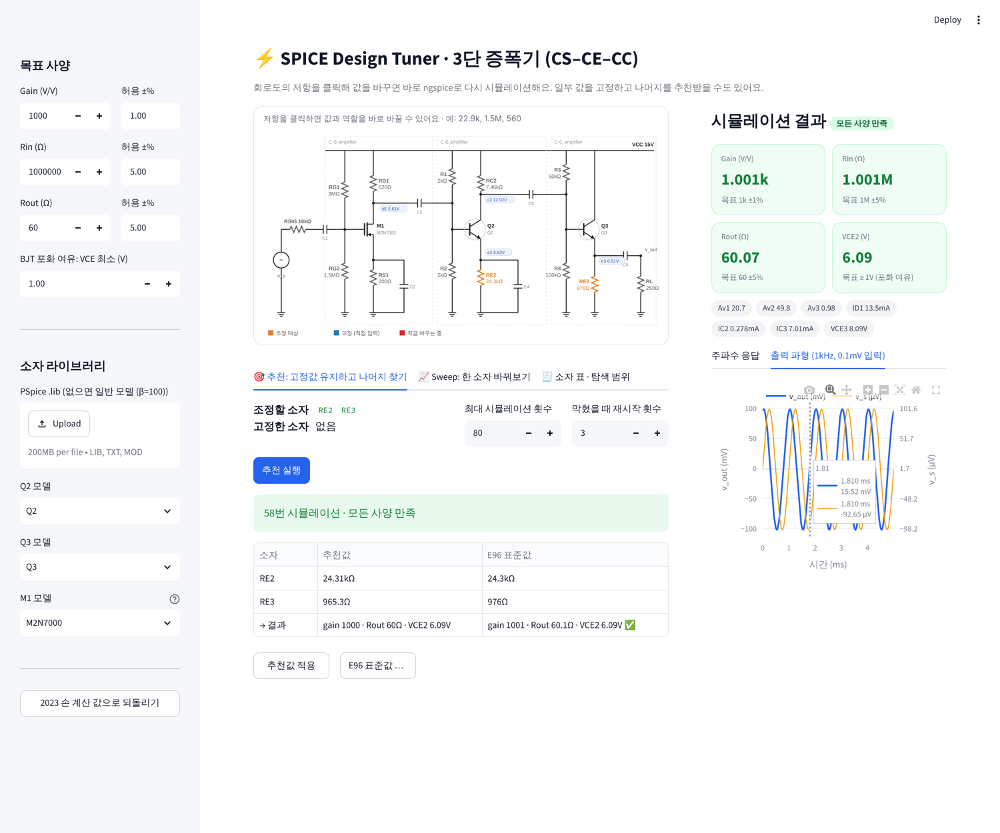
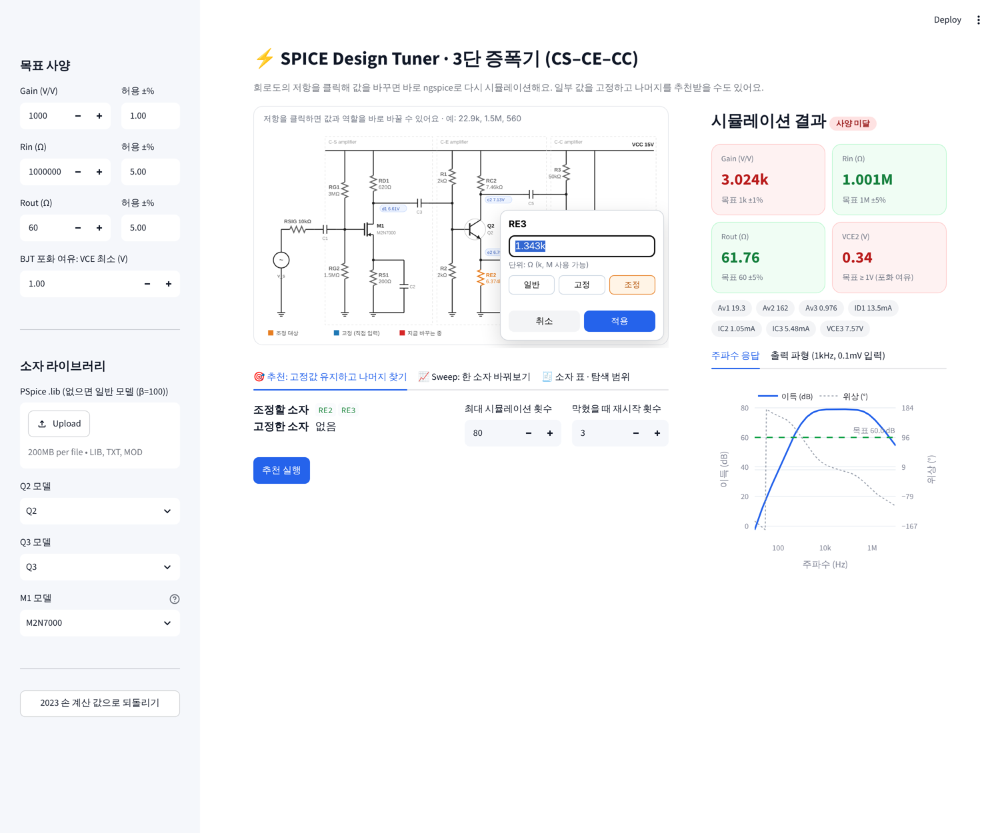

# spice-design-tuner

3단 증폭기(CS–CE–CC)의 소자값을 ngspice 시뮬레이션으로 자동 튜닝하는 도구.
목표 사양(gain 1000V/V, Rin 1MΩ, Rout 60Ω)을 넣으면 조정할 저항값을 찾아주고,
E96 표준값과 ±1% 공차에서도 사양이 유지되는지 확인한다.

핵심 결과
- 손 계산식 "한 번에 하나씩" 조정은 Q2를 포화 직전으로 몰아, 앞에서 맞춘 Rout이 깨짐 (60Ω → 20Ω)
- 튜너 해(RE2 22.99k, RE3 575Ω)는 ±1% 저항 공차에서 gain 980~1024, Rout 59.5~60.5Ω
- 자세한 내용: STEP1_NOTES.md, STEP3_NOTES.md

## 구조
- `circuits/three_stage/` 회로 하나 = 폴더 하나
  - `netlist.cir` 회로 (조정할 값은 `.param`)
  - `measure.control` 측정 방법 (gain, Rin, Rout, 바이어스)
  - `spec.yaml` 목표 사양과 동작점 제약
  - `tunables.yaml` 조정 소자와 범위, 2023 손 계산 기준선
- `models/generic.lib` 기본 BJT 모델 (과제 사양: β=100, Early 효과 없음)
- 과목 PSpice 라이브러리는 공개하지 않음. 앱에서 업로드하거나 로컬에 `models/course_project.lib`로 두면 기본값으로 쓰임
  (STEP1~3 메모의 수치는 과목 라이브러리 기준)
- `tuner/sim.py` ngspice 1회 실행 + 결과 파싱
- `tuner/optimize.py` scipy least_squares 튜너, 모든 시뮬레이션을 `runs/*/history.csv`에 기록

## 실행
    python3 tuner/sim.py circuits/three_stage            # 기준선 측정
    python3 tuner/optimize.py circuits/three_stage --init RE2=2000,RE3=200 --out runs/test

## 3단계: LLM 설계 리뷰어 (ANTHROPIC_API_KEY 필요)
- `circuits/three_stage/description.md` LLM에게 주는 회로 설명 (정답은 넣지 않음)
- `tuner/advisor.py` 시뮬레이션 기록을 읽고 진단 + 다음 시작점 최대 3개 제안 (claude-opus-5-5, JSON 출력)
- `tuner/strategies.py` 같은 시뮬레이션 예산(60회)에서 세 방식 비교
  - A 최적화만 / B 막히면 무작위 재시작 / C 막히면 LLM 제안으로 재시작
  - LLM이 낸 값도 반드시 ngspice로 검증 (`source=llm`으로 기록)
- 실행: `python3 tuner/compare.py A,B,C`

## 튜닝 웹앱 (app/)
배포: https://spice-design-tuner.streamlit.app/

- 회로도의 저항을 클릭해 값(22.9k, 1.5M 형식)과 역할(고정/조정)을 바로 수정 → 자동으로 다시 시뮬레이션
- 회로도에 DC 노드 전압 표시, 조정=주황 / 고정=파랑 / 지금 바꾸는 중=빨강
- 오른쪽: 사양 카드(통과 여부), 단별 이득·바이어스, 포화 경고, 주파수 응답·출력 파형 (마우스 오버로 좌표 확인)
- 탭: 추천(고정값 유지하고 조정 소자 값 찾기 + E96 검증), Sweep(한 소자 스윕, 마우스 오버), 소자 표(탐색 범위)
- 사이드바: 목표 사양·허용오차·VCE 최소값, .lib 업로드와 Q2/Q3/M1 모델 선택

### 내 PC에서 실행 (Windows 기준)
1. Python 3.10+ 설치
2. ngspice 설치: https://ngspice.sourceforge.io/download.html 에서 Windows 64bit zip을 받아 압축을 풀고,
   `Spice64\bin` 폴더를 PATH에 추가 (명령 프롬프트에서 `ngspice_con -v`가 나오면 성공. 앱은 콘솔용 ngspice_con을 자동으로 찾아 씀)
3. 이 폴더에서 `pip install -r requirements.txt`
4. `streamlit run app/app.py` → 브라우저가 자동으로 열림
